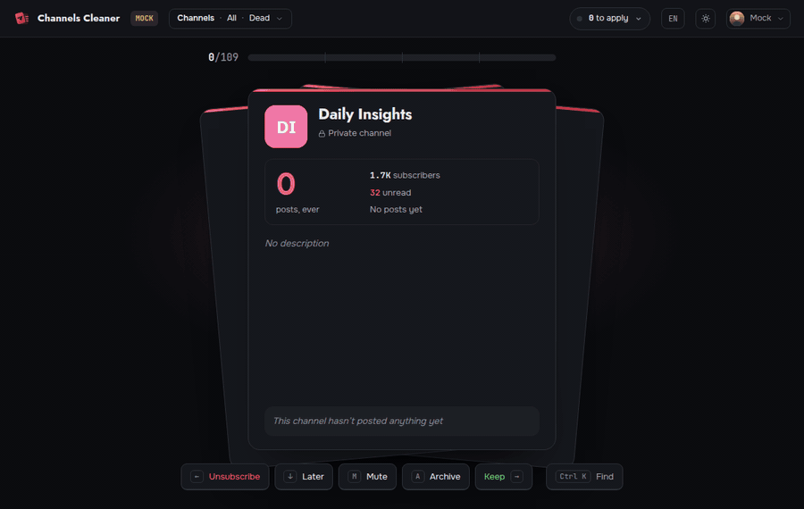
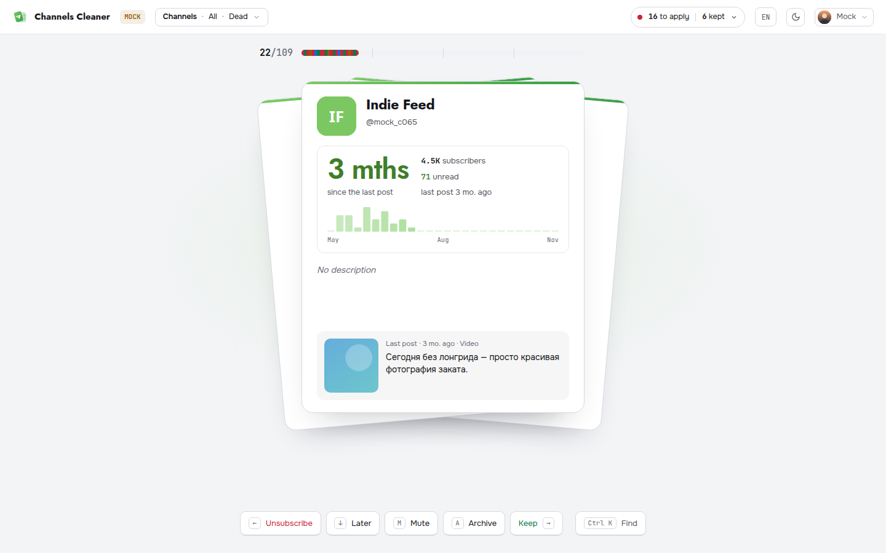
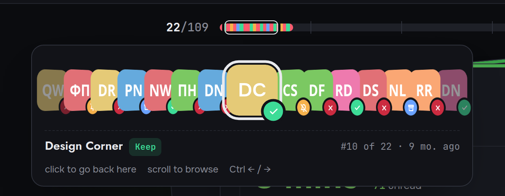
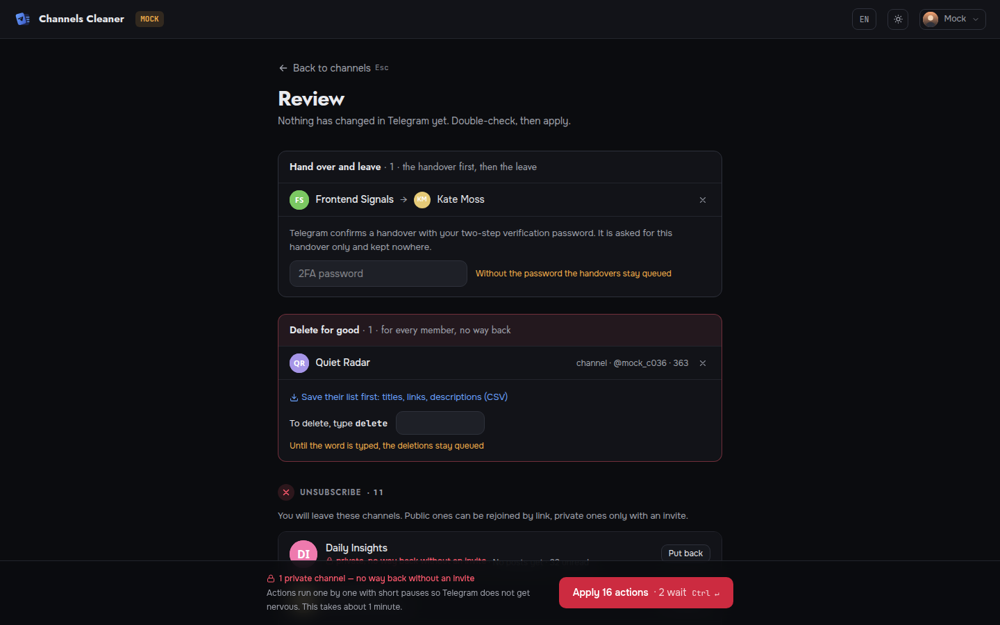
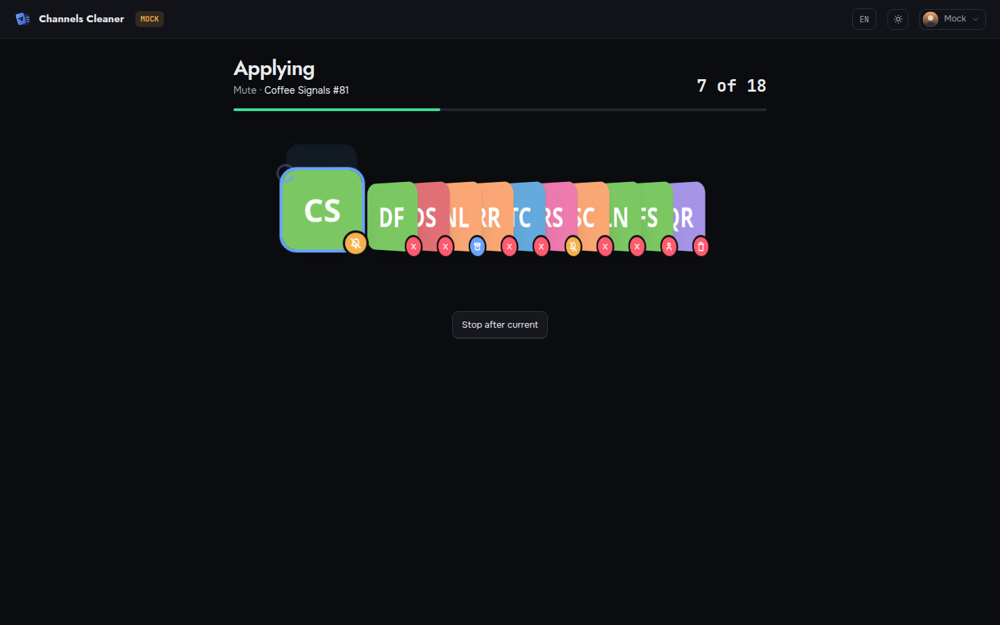

#  Channels Cleaner

[](https://github.com/asteroid-den/telegram-channels-cleaner/actions/workflows/ci.yml)
[](https://pypi.org/project/telegram-channels-cleaner/)
[](LICENSE)

Go through every Telegram channel you're subscribed to, one card at a time, and get rid of the
ones you stopped reading years ago. Swipe left to leave, right to keep, or mute and archive.
Nothing changes in Telegram until you've reviewed the whole batch.

It runs on your own computer: a small Python server (a [Kurigram](https://github.com/KurimuzonAkuma/pyrogram)
userbot + FastAPI) and a web UI that opens in your browser. No hosted service, no accounts.



## What it does

- **One card per channel, with the numbers that matter**: posts per week (or how long it's been
  silent), a 26-week activity chart, subscribers, unread count and a preview of the last post.
  The card takes its colour from the channel's avatar.
- **Five verdicts**: unsubscribe, keep, mute, archive or "later" (back of the deck). Swipe the
  card, click either side of it or use the keyboard.
- **Two orders**: dead channels first (never posted, then longest silence) or most unread first,
  each reversible.
- **The progress bar is your history.** Every decision lands in it in order, coloured by
  verdict. Hover it to see a magnified strip of avatars, click to go back to any decision and
  change it, or step through them with <kbd>Ctrl</kbd>+<kbd>←</kbd>/<kbd>→</kbd>.
- **Nothing happens until you confirm.** Unsubscribe, mute and archive are queued. The review
  screen groups them, flags private channels you can't rejoin without an invite, then applies
  them one by one with pauses, handling Telegram's flood waits.
- **Changed your mind later?** Turn an applied mute or archive into "keep" and the next run
  unmutes or unarchives the channel.
- **Results and export**: what's left of your subscriptions by last post, plus a CSV/JSON list
  of what you left, with `t.me` links for the public ones.
- **Several accounts**: add another Telegram account from the account menu and switch between
  them; each keeps its own chats, decisions and session.
- QR or phone login with two-step verification, English and Russian, dark and light themes.

| Deck (light theme) | History loupe |
| --- | --- |
|  |  |
| **Review** | **Applying** |
|  |  |

## Quick start

You need Python 3.12+ and either [uv](https://docs.astral.sh/uv/) or [pipx](https://pipx.pypa.io/).
The package includes the built UI, so no Node.js is required.

```bash
uvx telegram-channels-cleaner
```

or install it once and run it whenever you like:

```bash
pipx install telegram-channels-cleaner
telegram-channels-cleaner
```

A browser tab opens at <http://127.0.0.1:8765>. On your phone, open Telegram →
**Settings → Devices → Link Desktop Device** and scan the QR code. You can also log in with a
phone number and code; a two-step verification password is asked for when it's set.

### Try it without a Telegram account

Mock mode replaces Telegram with 120 generated channels:

```bash
uvx telegram-channels-cleaner --mock
```

The QR code "scans" itself after a few seconds. The phone code is `12345`; with `CC_MOCK_2FA=1`
the 2FA password is `mock`, which is also the one a transfer of ownership asks for. The screenshots
above are from mock mode.

### Docker

```bash
docker run --rm -p 127.0.0.1:8765:8765 -v telegram-channels-cleaner:/data \
  ghcr.io/asteroid-den/telegram-channels-cleaner:latest
```

Then open <http://127.0.0.1:8765>. Or from a checkout: `docker compose up -d`. Keep the
`127.0.0.1:` part of the port mapping: the UI has no password, and whoever can open it can act
on your Telegram account.

The image has a health check (`docker ps` shows `healthy` once the app answers). It looks at
`CC_PORT`, so change the port with that variable rather than a `--port` flag.

### From source

```bash
git clone https://github.com/asteroid-den/telegram-channels-cleaner.git
cd telegram-channels-cleaner
npm --prefix frontend ci && npm --prefix frontend run build   # Node.js 22.18+
uv run telegram-channels-cleaner
```

## Keyboard

| Key | Action |
| --- | --- |
| <kbd>←</kbd> / <kbd>→</kbd> | Unsubscribe / keep (← on a chat you own asks who gets it) |
| <kbd>↓</kbd> | Later: move to the back of the deck |
| <kbd>M</kbd> / <kbd>A</kbd> | Mute / archive |
| <kbd>L</kbd> | Free the public link (chats you own) |
| <kbd>Ctrl</kbd>+<kbd>Z</kbd> or <kbd>Backspace</kbd> | Undo the last decision |
| <kbd>Ctrl</kbd>+<kbd>←</kbd> / <kbd>→</kbd> | Step back / forward through decisions you've made |
| <kbd>Ctrl</kbd>+<kbd>K</kbd> | Find a chat by name and put it on top |
| <kbd>Enter</kbd> | Go to the review |
| <kbd>Ctrl</kbd>+<kbd>Enter</kbd> | Apply (on the review screen) |
| <kbd>Esc</kbd> | Back to the deck |

Letter keys work on any keyboard layout. On macOS, <kbd>Cmd</kbd> works in place of
<kbd>Ctrl</kbd>.

## Privacy and safety

**Read this before logging in with your real account.**

- **The session file is your Telegram account.** Anyone who copies it can read your messages
  and act as you, without your password or 2FA. It lives in the data directory below, which
  the app keeps readable only by your user (on Linux and macOS). Don't sync it to the cloud,
  don't share it.
- **Everything stays on your machine.** The server listens on `127.0.0.1` only, talks to
  Telegram directly and nowhere else. There is no telemetry.
- **The UI has no password**, because it's meant for one person on their own computer. Don't
  expose it to a network (`--host 0.0.0.0`) you don't fully control.
- **Other websites can't use it.** Listening on `127.0.0.1` doesn't stop a page open in your
  browser from sending requests to it. The app answers only requests addressed to `localhost`
  (against DNS rebinding) and takes changes only from its own page (against cross-site
  requests), so no site can queue or apply anything.
- **Log out and delete local data** in the account menu ends the session on Telegram's side
  and wipes everything stored for that account. Ending the session from Telegram
  (**Settings → Devices**) also works; delete the data directory afterwards.

### Where the data lives

| How you run it | Location |
| --- | --- |
| `uvx` / `pipx` on Linux | `~/.local/share/telegram-channels-cleaner` (or `$XDG_DATA_HOME`) |
| `uvx` / `pipx` on macOS | `~/Library/Application Support/telegram-channels-cleaner` |
| `uvx` / `pipx` on Windows | `%APPDATA%\telegram-channels-cleaner` |
| From source | `./data` in the checkout |
| Docker | the `/data` volume |

The startup message prints the exact path. Inside:

- `sessions/*.session`: one Telegram session per account (`account.session` for the first one).
- `sessions/*.device.json`: the device profile each session presents to Telegram.
- `cleaner.sqlite3`: the channel cache, your decisions and stats. Before an update changes
  its structure, the app copies it next to it (`cleaner.sqlite3.before-<version>`).
- `media/`: cached avatars and post thumbnails.
- `logs/app.log`: what the app logged, kept to four files of 1 MB. Worth attaching when you
  report a problem; it has chat ids and titles in it, but never the session.

### About the API id and the device profile

Telegram identifies third-party clients by an `api_id`. Out of the box this app uses the public
`api_id` of Telegram Desktop and, on first login, picks a plausible Telegram Desktop device
profile (OS, app version, language) from
[`device_profiles.json`](src/channels_cleaner/telegram/device_profiles.json). The profile is
stored with the session and never changes after that, so in **Settings → Devices** you'll see
one ordinary desktop session rather than a new device on every start.

To be clear about what that means: the app presents itself as Telegram Desktop. Using an
unofficial client is at your own risk under
[Telegram's Terms of Service](https://core.telegram.org/api/terms), and Telegram can limit
accounts it considers abusive. For a cleaner setup, register your own app at
<https://my.telegram.org/apps> and set `CC_API_ID` and `CC_API_HASH`.

### Pace

Reading is cheap: channel details and the last 100 post dates are fetched lazily, one card at a
time, and cached for 72 hours. Actions run one after another with a random 1.5–3 s pause. If
Telegram replies with a flood wait, the job sleeps for the time it was told to (the UI shows a
countdown) and carries on. You can stop the job at any point; whatever wasn't applied stays
queued.

Channels and supergroups you own or administer have a deck of their own (open the settings menu
and pick "I run it"). Leaving a chat as an admin costs you your admin rights, so the review screen
warns about it. Swiping left on a chat you **created** asks what to do with it: hand it over to one of
its admins and leave, leave it without an owner, or delete it (Telegram deletes chats up to about
1000 members). A handover is confirmed with your 2FA password on the review screen.

## Configuration

Everything is optional. Use environment variables or a `.env` file in the working directory
(see [`.env.example`](.env.example)).

| CLI flag | Env var | Default | |
| --- | --- | --- | --- |
| `--host` | `CC_HOST` | `127.0.0.1` | Address to listen on |
| `--port` | `CC_PORT` | `8765` | Port |
| `--no-browser` | `CC_NO_BROWSER=1` | off | Don't open a browser tab |
| `--mock` | `CC_MOCK=1` | off | Fake Telegram backend |
| | `CC_MOCK_CHANNELS` | `120` | Number of generated channels |
| | `CC_MOCK_SUPERGROUPS` | `60` | Number of generated supergroups |
| | `CC_MOCK_2FA=1` | off | Ask for a 2FA password in mock mode |
| | `CC_DATA_DIR` | see above | Sessions, database, media cache, log |
| | `CC_API_ID`, `CC_API_HASH` | Telegram Desktop | Your own Telegram API credentials |
| | `CC_APPLY_DELAY_MIN`, `CC_APPLY_DELAY_MAX` | `1.5`, `3.0` | Pause between actions, seconds |
| | `CC_FULL_INFO_TTL_HOURS` | `72` | How long channel details stay cached |
| `-v` | | off | Debug logging |

## Development

```bash
uv sync
npm --prefix frontend ci

uv run telegram-channels-cleaner --mock --dev   # API only, on :8765
npm --prefix frontend run dev          # UI with hot reload on :5173, proxies /api
```

The app migrates its database on start. A schema change is a model change plus a revision, generated against a
database at the latest revision (the app's own, `./data/cleaner.sqlite3`, once it has started):

```bash
uv run alembic revision --autogenerate -m "add something to channels"
```

Checks, the same as CI:

```bash
uv run ruff check && uv run ruff format --check && uv run pyright && uv run pytest
cd frontend && npm run lint && npm run format:check && npm run test && npm run build
```

```
src/channels_cleaner/
  telegram/    gateway protocol; Kurigram and mock implementations; device profiles
  services/    auth state machine, sync, lazy channel info + activity, apply job, stats
  api/         FastAPI routes: REST + Server-Sent Events
  database/    SQLAlchemy models, DAO (one class per model, combined in DAO), session manager
  migrations/  Alembic revisions, applied by the app itself on every start
  enums.py     kinds, roles, decisions, statuses (StrEnum, lowercase values)
frontend/src/  Vue 3 + Vite + TypeScript, Pinia, vue-i18n, Tailwind
  stores/      auth, deck (queue, history, rewind), apply, ui
  views/       Login, Deck, Review, Apply, Results
  components/  swipe deck, channel card, progress bar + loupe, summary pill…
```

### Releasing

Push a `v*` tag matching `__version__` in
[`src/channels_cleaner/__init__.py`](src/channels_cleaner/__init__.py). The
[release workflow](.github/workflows/release.yml) builds the wheel with the UI, publishes it to
PyPI through trusted publishing and pushes a multi-arch image to GHCR. One-time setup: on
pypi.org, add a pending trusted publisher for project `telegram-channels-cleaner` with workflow
`release.yml` and environment `pypi`, and create an environment named `pypi` in the
repository settings.

## License

[MIT](LICENSE)
